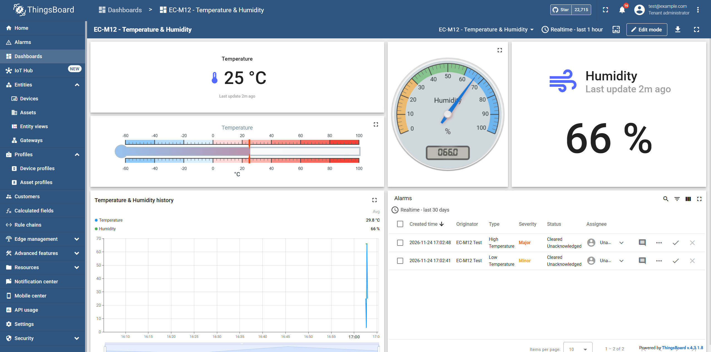

# NORVI EC-M12 + ThingsBoard: Temperature & Humidity (RS-485, cellular)

Ready-to-import ThingsBoard device profile, alarm rules and dashboard for the
[NORVI EC-M12-BC-C6-C-B](https://norvi.io/products/battery-powered-cellular-iot-data-logger/)
(battery powered, SIM7070) reading an **XY-MD02** Modbus RTU temperature/humidity sensor over
RS-485 and sending the data to ThingsBoard over cellular (Cat-M / NB-IoT / 2G, MQTT).

**Tested on:** ThingsBoard CE **v4.3.1.8** (self-hosted, Docker), 24 Nov 2026. The sketch was
tested on an EC-M12-BC-C6-C-B (board V3) with an XY-MD02.
The alarm rules use the Alarm Rules 2.0 format, so ThingsBoard **4.3 or newer** is required.

## What's in this folder

| File | Purpose |
|---|---|
| `device-profile.json` | Device profile "EC-M12 - Temperature & Humidity (RS485)" |
| `alarm-rules/high-temperature.json` | Alarm rule: High Temperature (Major) |
| `alarm-rules/low-temperature.json` | Alarm rule: Low Temperature (Minor) |
| `dashboard.json` | Dashboard (6 widgets): history chart, Temperature card, Humidity card, Alarms table, Humidity gauge, Temperature scale |
| `firmware/ec_m12_xy_md02_thingsboard/` | Arduino sketch (placeholders only: add your own APN and token) |

## Telemetry keys

| Key | Unit | Description |
|---|---|---|
| `temperature` | °C | Air temperature from the XY-MD02 |
| `humidity` | %RH | Relative humidity from the XY-MD02 |

## Alarms

| Alarm | Severity | Created when | Cleared when |
|---|---|---|---|
| High Temperature | Major | `temperature` > 35 | `temperature` < 33 |
| Low Temperature | Minor | `temperature` < 5 | `temperature` > 7 |

## Import steps (in this order)

1. **Device profile.** Profiles > Device profiles > **+** > **Import device profile** > `device-profile.json`.
2. **Alarm rules.** Open the imported profile > **Alarm rules** tab > **+ (Add alarm rule)** > import `alarm-rules/high-temperature.json`, then `low-temperature.json`.
3. **Device.** Entities > Devices > **+** > Add new device, with the profile "EC-M12 - Temperature & Humidity (RS485)". Open it > **Manage credentials** and copy the access token (keep it private).
4. **Dashboard.** Dashboards > **+** > **Import dashboard** > `dashboard.json`. It finds devices by profile name, so no device has to be chosen by hand.

If a widget stays empty, check that the device's profile name matches exactly and that the
telemetry keys are `temperature` and `humidity`.

## MQTT topic and payload

| Item | Value |
|---|---|
| Host | `mqtt.thingsboard.cloud` or your own ThingsBoard host (port 1883) |
| MQTT username | the device access token |
| MQTT password | empty |
| Topic | `v1/devices/me/telemetry` |
| Payload | `{"temperature":32.75,"humidity":57.73}` |

You can test without hardware by adding telemetry on the device's **Latest telemetry** tab,
or by sending the same payload from any MQTT client.

## Hardware

- NORVI EC-M12-BC-C6-C-B with a SIM card (set your SIM's APN in the sketch).
- XY-MD02 on the M8 8-pin connector: pin 5 = RS485-A, pin 6 = RS485-B, pin 1 = GND, pin 4 = sensor supply.
  The output (5 V or 12 V) is chosen with the AUX jumper and switched on by setting **PA4 HIGH**.
- **RS-485 direction pin:** `PB5` on board V2, `PB4` on board V3 (hardware version 02). Set `RS485_FC` in the sketch to match your board.
- Sensor settings used: slave address 1, 9600 baud 8N1, input registers `0x0001` (temperature)
  and `0x0002` (humidity), raw value / 100. Other units may use a different scale, so check your manual.

## Firmware

- Arduino IDE board: **Generic STM32L0 Series**, part number **Generic L072CZTx**, U(S)ART support **Enabled (generic 'Serial')**, USB support **CDC**, upload method **STM32CubeProgrammer (SWD)** with an ST-Link.
- Power source jumper: position 2 (USB) while testing.
- Library: ModbusMaster.
- Edit `APN` and `TB_TOKEN` in your own copy. Never commit them.
- Open the Serial Monitor at 115200. A good run ends with `Published OK`.

## Licence

TODO: confirm licence with the reviewer (e.g. MIT).

## Links

- [NORVI EC-M12 product page](https://norvi.io/products/battery-powered-cellular-iot-data-logger/)
- [NORVI EC-M12-BC-C6-C-B datasheet](https://norvi.io/docs/norvi-ec-m12-bc-c6-c-b-datasheet/)

